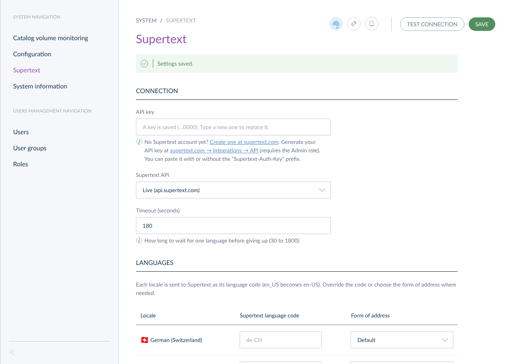
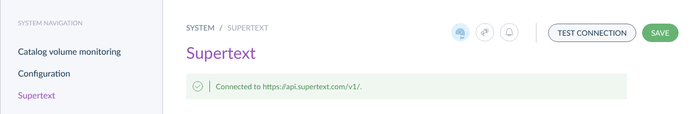
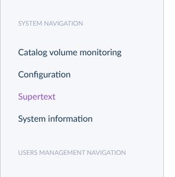
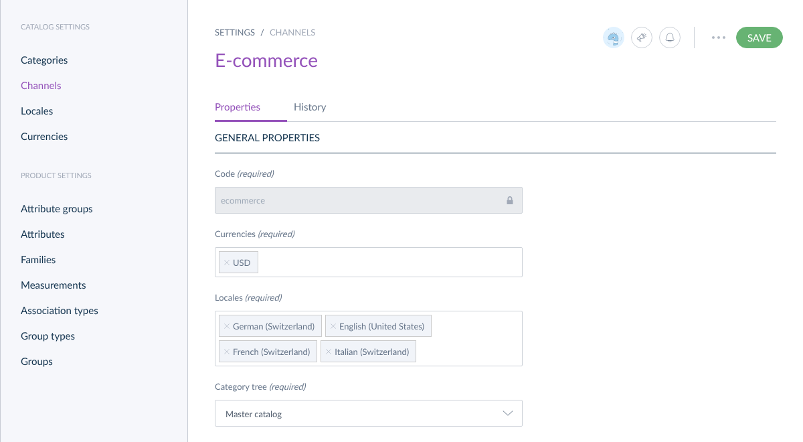

# Installation guide — Supertext Translation for Akeneo PIM

For administrators: install the bundle, enter the Supertext API key, set up the locales and choose who may translate.

## Requirements

- Akeneo PIM **Community Edition 2026.4** (tested; 2026.3 should work too), installed from the Community Standard Edition (`akeneo/pim-community-standard`), with its PHP 8.3, MySQL 8.4 and Elasticsearch 8 requirements.
- Node.js 18 and Yarn, which Akeneo needs anyway to build its front end: the bundle adds screens, so the front end is rebuilt once after installing.
- A Supertext account and an API key. No Supertext account yet? Create one at [supertext.com](https://www.supertext.com/person/en/account/signin). Generate your API key at [supertext.com → Integrations → API](https://www.supertext.com/en/integrations/api) (requires the Admin role).
- Outgoing HTTPS from the Akeneo server to `api.supertext.com` (and, for the optional version information, to Supertext's Commando Center; for [Translation review](#translation-review), to Supertext's review service), and PHP's curl extension (part of Akeneo's requirements).
- `AKENEO_PIM_URL` set to the PIM's public address, as Akeneo expects anyway (it is the site URL in version reports and the base of the ping address).

The bundle is for the self-hosted Community Edition. Akeneo's SaaS editions (Serenity, Growth) don't run third-party bundles.

## Install

1. Add the package to your Akeneo project (it is not on Packagist yet, so add the repository first):

   ```bash
   composer config repositories.supertext vcs https://github.com/Supertext/Akeneo-Supertext-Translation
   composer require supertext/akeneo-supertext-translation:dev-main
   ```

2. Register the bundle in `config/bundles.php`:

   ```php
   return [
       Supertext\AkeneoTranslationBundle\SupertextTranslationBundle::class => ['all' => true],
   ];
   ```

3. Add its routes in `config/routes/supertext_translation.yml`:

   ```yaml
   supertext_translation:
       resource: '@SupertextTranslationBundle/Resources/config/routing.yml'
   ```

4. Rebuild the cache and the front end (the same steps as Akeneo's `make upgrade-front`):

   ```bash
   rm -rf var/cache && bin/console cache:warmup
   bin/console pim:installer:assets --clean
   yarn run less
   yarn run webpack
   yarn run update-extensions
   ```

   Without this step the *Translate with Supertext* entry and the System → Supertext page don't appear.

The bundle needs no database migration: it keeps its settings as one row in Akeneo's `pim_configuration` table (code `supertext_translation`), and the state of the version reports and the latest API key check in a second row (`supertext_translation_reporter`).

### Update

```bash
composer update supertext/akeneo-supertext-translation
```

Then repeat step 4. See [CHANGELOG.md](../CHANGELOG.md) for what changed.

### Uninstall

1. Remove the line from `config/bundles.php` and delete `config/routes/supertext_translation.yml`.
2. `composer remove supertext/akeneo-supertext-translation`, then repeat step 4.
3. Optional: delete the saved settings with `DELETE FROM pim_configuration WHERE code IN ('supertext_translation', 'supertext_translation_reporter');`.

Translations that were already made stay in your products: they are ordinary product values.

## API key

Open **System → Supertext**, paste the key into **API key** and click **Save**. Every save checks the key with Supertext automatically (free of charge, nothing is translated) and the page shows the result with its time; **Test connection** runs the same check again, with the key typed in the form if there is one. An invalid key never blocks saving. You can paste the key with or without the `Supertext-Auth-Key` prefix Supertext shows it with.

| Result shown | Meaning |
| --- | --- |
| API key checked: the connection to Supertext works. | Supertext accepted the key. |
| Supertext rejected the API key. … | Supertext answered 401/403: the key is incomplete, revoked or for another environment. The message links to supertext.com → Integrations → API and the account signup. |
| No API key is set yet. … | Neither a saved key nor `SUPERTEXT_API_KEY`. |
| The API key couldn't be checked because Supertext can't be reached. … | Network error, timeout or HTTP 5xx: the Akeneo server can't reach `api.supertext.com`. |
| The API key couldn't be checked: Supertext answered with an error (…). … | Any other answer; the HTTP status is shown. |

The check also runs when the key from `SUPERTEXT_API_KEY` changes (the bundle compares a SHA-256 fingerprint kept in the database, never the key itself) and when Supertext rejects the key during a translation (the result becomes *rejected* without another request).



The page shows the account and key links: no Supertext account yet? Create one at supertext.com (<https://www.supertext.com/person/en/account/signin>). Generate your API key at supertext.com → Integrations → API (<https://www.supertext.com/en/integrations/api>; requires the Admin role).



Instead of the settings page you can set the key on the server as the environment variable `SUPERTEXT_API_KEY` (for example in `.env.local` or your hosting platform). The variable takes precedence; the page then says the key is set by the environment. The key is never shown again after saving and never sent to the browser.

The entry **Supertext** sits in the **System** menu, next to *Configuration*:



## Languages

Akeneo translates between **locales**, and a locale is active when a channel uses it. To translate into a language, add its locale to a channel under **Settings → Channels**:



- Values of attributes that are *localizable* get one value per locale. Values that are also *scopable* (per channel) are translated into the locales of their channel only.
- **Language mapping.** Supertext accepts only its own language codes. Under **System → Supertext → Languages** every activated locale has a **Supertext language** drop-down with Supertext's languages (name in your interface language, with the code). The same choice is used when the locale is the source.
  - The drop-down is preselected: with the Supertext language the locale equals (apart from case and `_`/`-`: `de_CH` → `de-CH`, `en_US` → `en-US`, `pt_BR` → `pt-BR`), else with its default. Until you save, the preselection is also what a translation uses. Defaults (Supertext SDK 0.4.0):

    | Locale | Supertext language |
    | --- | --- |
    | `de`, `en`, `fr`, `it`, `pt` (bare) | `de-DE`, `en-US`, `fr-FR`, `it-IT`, `pt-PT` |
    | `zh`, `zh_CN`, `zh_SG` / `zh_TW`, `zh_HK`, `zh_MO` | `zh-Hans` / `zh-Hant` |
    | `sr`, `sr_Latn_RS` / `sr_Cyrl_RS` | `sr-Latn` / `sr-Cyrl` |
    | a region of a language Supertext offers without one | the bare language: `es_ES` → `es`, `nl_NL` → `nl`, `sv_SE` → `sv`, `ja_JP` → `ja`, `nb_NO` → `nb` |

  - Nothing else is guessed: locales such as `en_IE`, `en_AU`, `de_LI`, `fr_BE`, `sr_RS` or `gsw` have no default. Their drop-down shows *— Choose —* with the note *No default for this locale*, the translate dialog greys them out, and they can't be translated until you choose a language.
  - You can choose another variant than the preselected one, e.g. `de-CH` for a `de_DE` locale whose texts follow Swiss spelling, or `gsw-u-sd-chzh` (Swiss German, Zurich). Saving stores the chosen language of every locale; only languages from Supertext's list are accepted.
  - The source is sent as Supertext's bare language (`en_US` → `en`, a `de_DE` mapped to `de-CH` → `de`).
  - There is no environment variable or config file for the mapping: it lives only on this page (in Akeneo's database).
  - Updating from an earlier version keeps every saved language as it is, also a code Supertext doesn't list (it stays selected and can be saved again). Locales that had no language (e.g. `es_ES`) are now preselected with their default.
- **Form of address** per locale: *Default*, *Formal* or *Informal* (for languages that distinguish them, such as German *Sie* and *du*). Supertext doesn't offer it for English (`en-GB`, `en-US`), Swiss German, Romansh (`rm`), Albanian (`sq`) and Serbian; for those the page shows a note instead of the choice, and a *Formal* or *Informal* saved earlier is ignored (Supertext's default tone is used).
- **Translation review** per locale: a checkbox, off by default. See [Translation review](#translation-review).

Supertext's languages (October 2026): targets `bg`, `cs`, `da`, `de-AT`, `de-CH`, `de-DE`, `el`, `en-GB`, `en-US`, `es`, `fi`, `fr-CH`, `fr-FR`, `gsw-u-sd-chbe`, `gsw-u-sd-chzh`, `hr`, `hu`, `it-CH`, `it-IT`, `ja`, `ko`, `nb`, `nl`, `pl`, `pt-BR`, `pt-PT`, `rm`, `ru`, `sk`, `sl`, `sq`, `sr-Cyrl`, `sr-Latn`, `sv`, `tr`, `zh-Hans`, `zh-Hant`; sources (bare) `bg`, `cs`, `da`, `de`, `el`, `en`, `es`, `fi`, `fr`, `gsw`, `hr`, `hu`, `it`, `ja`, `ko`, `nb`, `nl`, `pl`, `pt`, `rm`, `ru`, `sk`, `sl`, `sq`, `sr`, `sv`, `tr`, `zh`. `bin/console supertext:check` lists every activated locale with the code it is sent as (mapping, exact match or default), or *not mapped*.

## Which values are translated

Localizable **text** and **text area** attributes, rich text included (headings, bold text, links and lists are kept). Everything else (identifiers, options, numbers, assets, …) stays as it is. The [user guide](USER_GUIDE.md#what-is-translated) has the details.

## Interface languages

The bundle's screens (the *Translate with Supertext*, *Export for translation* and *Import translation* dialogs, System → Supertext and their messages) are available in English, German, French and Italian. They follow each user's Akeneo interface language: the *UI locale* in the user's own settings (user menu → *My settings*). Other UI locales show the English texts. Console commands and log entries stay English.

## Permissions

| Action | Akeneo permission (System → Roles → Permissions) |
| --- | --- |
| Translate a product | *Products → Edit attributes of a product* |
| Translate a product model | *Product models → Edit attributes of a product model* |
| Export for translation, Import translation | The same as translating the product or product model |
| System → Supertext (API key and languages) | *System configuration* (the same permission as System → Configuration) |

*Export for translation* and *Import translation* need the same permission as translating (*Edit attributes* of a product or product model, for every product a file holds). There is nothing to configure for them and no API key is needed (nothing is sent to Supertext). Uploads larger than 10 MB are refused before they are read (PHP's `upload_max_filesize` and `post_max_size` must allow the file too); files are parsed in memory and never stored.

There is no separate permission for translating: whoever may edit a product's attributes may translate it. In a new Akeneo installation every role has all permissions; remove *System configuration* from the roles that shouldn't see the API settings.

## Settings

| Setting | Where | Default | |
| --- | --- | --- | --- |
| API key | System → Supertext, or `SUPERTEXT_API_KEY` | none | The variable takes precedence. Stored in `pim_configuration` (code `supertext_translation`). |
| Supertext API | System → Supertext | Live | *Live* (`https://api.supertext.com/v1/`), *Staging*, *Testing* or *Custom address*. `SUPERTEXT_API_URL` overrides it (for tests against a stand-in). |
| API address | System → Supertext | none | Only for *Custom address*. |
| Timeout (seconds) | System → Supertext | 180 | How long to wait for one language (30 to 1800). |
| Send version information to Supertext | System → Supertext, or `SUPERTEXT_VERSION_REPORTS` | on | See *Version information* below. `SUPERTEXT_VERSION_REPORTS=0` (or `false`, `off`, `no`) turns it off, `1` on; the variable takes precedence over the checkbox. |
| Supertext language | System → Supertext → Languages | the exact match, else the SDK default (`es_ES` → `es`), else none | Per locale, a drop-down with Supertext's list (e.g. `de-CH`, `es`). Locales without one (*— Choose —*) can't be translated. See *Languages*. |
| Form of address | System → Supertext → Languages | Default | Per locale: Default, Formal, Informal (only for languages that offer it). |
| Translation review | System → Supertext → Languages | off | Per locale: translations into it go through Supertext's review service (see [Translation review](#translation-review)). Stored with the locale's language (`languages.<locale>.review`). |
| Review service address | `SUPERTEXT_REVIEW_URL` | Supertext's review service | Address of the review service for locales with *Translation review* on. Set but empty turns review off for every locale (the checkboxes are then read-only). Only change it when Supertext gives you another address. |

The bottom of System → Supertext shows the installed version of the bundle (as Composer reports it) with a link to its GitHub release; `bin/console supertext:check` prints it too.

## Translation review

With **Translation review**, people check the translations on the website itself and correct them there: customers or Supertext linguists open the original and the translated page side by side in Chrome with the *Supertext Localization Review* extension and fix texts in a side panel. Their corrections come back into Akeneo.

Turn it on per language for the locale that is translated **into**: **System → Supertext → Languages**, tick **Translation review** next to the locale's *Supertext language* drop-down (e.g. *German (Switzerland)*) and save. Untick it to turn it off again; nothing else changes.

- Translations into that locale then go through Supertext's review service instead of directly to Supertext. It answers exactly like Supertext and passes everything on with your API key, so billing, languages, form of address and error messages stay the same. Other locales keep going directly to Supertext.
- The review service keeps every translation of your account. A text it has translated before gets the same translation again (without a new Supertext call), and once a reviewer has corrected it, the corrected text.
- **Corrections arrive with the next translation:** after a review, translate the products again (*Translate with Supertext* with *Overwrite existing translations*, or `supertext:translate … --overwrite`) to write the corrections into Akeneo. As always, overwriting replaces manual changes in the translated values.
- Reviewers get a review link for your site from Supertext; nothing to set up in Akeneo.
- The review service works with keys of the **live** Supertext API. With *Staging*, *Testing* or a custom address, leave review off.
- *Export for translation* and *Import translation* don't use the review service (they send nothing to Supertext). The API key check (*Test connection*, after saving) still goes directly to Supertext.

## Version information

**Send version information to Supertext** (System → Supertext) is on by default:

> Sends the site URL and the versions of this plugin, the PIM and the runtime to Supertext when you save these settings and after an update, so Supertext support can see which version you run. No content, no API key and no personal data are sent.

A report goes from the Akeneo server (never from the browser) to Supertext's Commando Center when the settings are saved, after an update of the bundle, Akeneo or PHP (noticed on the next request to System → Supertext, the translate dialog or a `supertext:` command), when the result of the API key check changes, and on `bin/console supertext:check`. It contains exactly: the site URL (`AKENEO_PIM_URL`, else the address the request came in on), the bundle's name (`Akeneo-Supertext-Translation`) and version, the Akeneo PIM and PHP versions, the Supertext SDK version, whether an API key is set, the result of the API key check (status, time, HTTP status, Supertext's error code) and the address of the ping endpoint. **No content, no API key and no personal data.** A report that fails is not retried for an hour and never slows down or breaks a save or a translation.

To turn it off, clear the checkbox and save, or set `SUPERTEXT_VERSION_REPORTS=0` on the server (it wins over the checkbox, which is then read-only). Nothing at all is sent then, and the ping endpoint answers 404. The API key check keeps running either way.

**Ping endpoint:** `GET <AKENEO_PIM_URL>/supertext/ping?challenge=…` is public (no login, no session, answered before Akeneo's login firewall) and answers only `{"ok":true,"plugin":"Akeneo-Supertext-Translation","challenge":"…"}` with `Cache-Control: no-store`, so Supertext can see that the PIM is reachable from the internet. It returns nothing else: no versions, no settings, no data. If a reverse proxy or firewall in front of Akeneo only lets known paths through, allow `/supertext/ping`.

## Console commands

```bash
bin/console supertext:check                                      # key check, language mapping, version report
bin/console supertext:translate praline-box-16 --from=en_US      # into all other locales
bin/console supertext:translate sku-1 sku-2 --from=en_US --to=de_CH,fr_CH --overwrite
bin/console supertext:translate dark-chocolate-bar --model --from=en_US   # product models by code
```

Products are given by identifier or UUID. Without `--overwrite`, values that already have text are kept.

## Troubleshooting

| Problem | What to do |
| --- | --- |
| No *Translate with Supertext* entry in the product's "…" menu, or no System → Supertext | The front end wasn't rebuilt after installing: repeat step 4 of *Install*, then reload the browser. Check that the user has the permissions above. |
| "No Supertext API key is configured." | Enter the key under System → Supertext or set `SUPERTEXT_API_KEY`. No Supertext account yet? Create one at supertext.com. Generate your API key at supertext.com → Integrations → API (requires the Admin role). |
| "Authentication failed. Please check the Supertext API key." | The key is wrong or was revoked: generate a new one at <https://www.supertext.com/en/integrations/api> and save it. |
| "Supertext rejected the API key" on System → Supertext | Check that the whole key was copied (or `SUPERTEXT_API_KEY`), or generate a new one at <https://www.supertext.com/en/integrations/api> (Admin role required). No Supertext account yet? Create one at <https://www.supertext.com/person/en/account/signin>. Save again or click *Test connection*. |
| "The API key couldn't be checked because Supertext can't be reached" | The Akeneo server can't reach `api.supertext.com` (firewall, proxy, DNS). Translations need the same connection. |
| "The language … has no Supertext language." / *No default for this locale* | The locale has no default (e.g. `en_IE`): choose one in its *Supertext language* drop-down under System → Supertext → Languages (see *Languages*), then save. |
| "Supertext offers no formal or informal tone for this language." | Open System → Supertext → Languages and save once (a *Formal*/*Informal* saved for such a language is removed). |
| "Supertext does not support this language pair" | Check the mapping of both locales under System → Supertext → Languages (source and target must differ and be Supertext languages). |
| `supertext:check` says "Version reports to Supertext: not sent (set AKENEO_PIM_URL …)" | Commands don't know the PIM's address without `AKENEO_PIM_URL`; set it in `.env.local` (Akeneo uses it for e-mails and the API too). |
| "Too many requests to Supertext." | The API limits requests per second per key. The bundle already retries; wait a moment and try again. |
| "Timed out waiting for the Supertext translation." | Raise *Timeout* under System → Supertext, or translate fewer languages at once. |
| "Akeneo did not accept the translation: …" | Akeneo's own validation rejected a translated value (for example a text attribute's maximum length). That language is left unchanged; the others are saved. |
| "Your Supertext translation limit is exceeded." | Upgrade your Supertext subscription. |
| A language is greyed out in the dialog | None of the product's text values belongs to a channel with that locale. Add the locale to the channel (Settings → Channels). |
| "Authentication failed" only for locales with *Translation review* | The review service only works with keys of the live Supertext API: with *Staging*, *Testing* or a custom address leave review off. |
| Reviewers' corrections don't show up in Akeneo | They arrive with the next translation: translate the products into that locale again with *Overwrite existing translations*. Check that the locale's *Translation review* is ticked. |
| The *Translation review* checkboxes are read-only | `SUPERTEXT_REVIEW_URL` is set but empty on the server, which turns review off for every locale. Remove the variable to use Supertext's review service. |
| Errors in detail | `var/logs/prod.log` (search for "Supertext"). |
